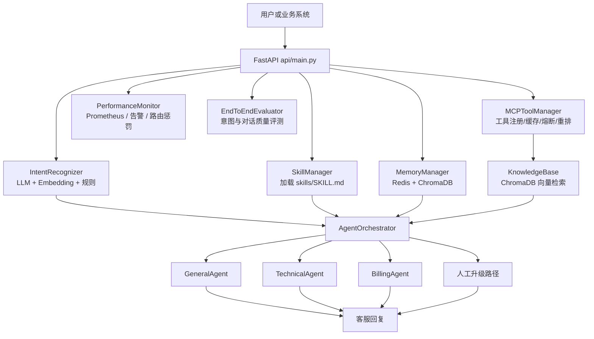
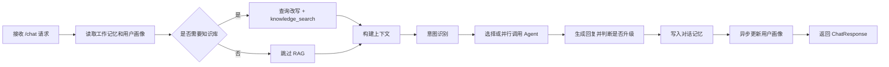
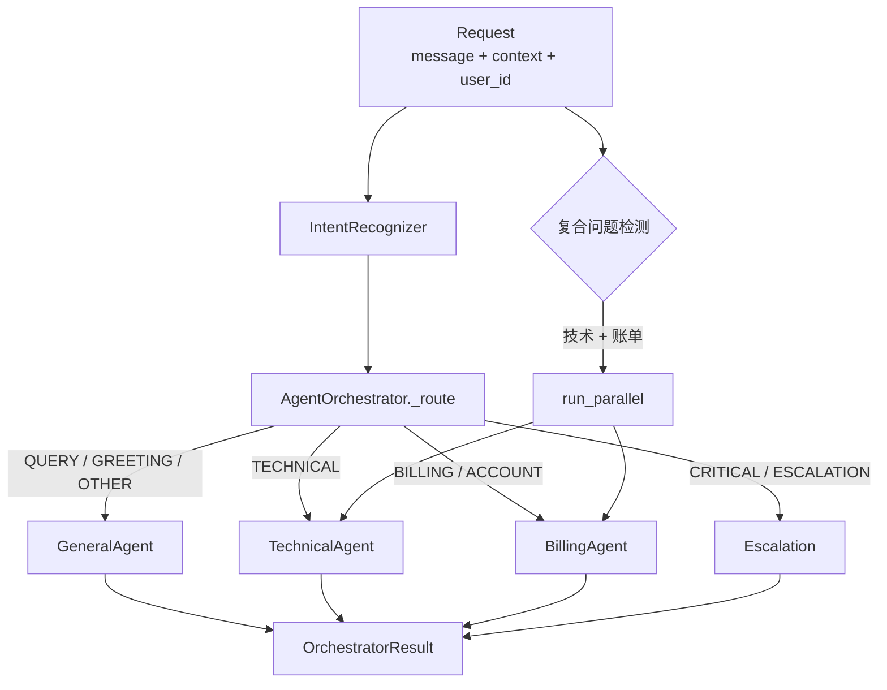
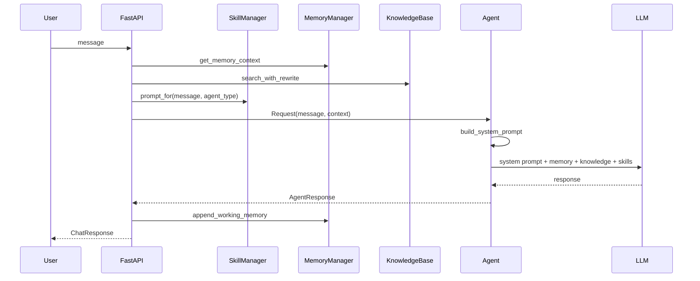
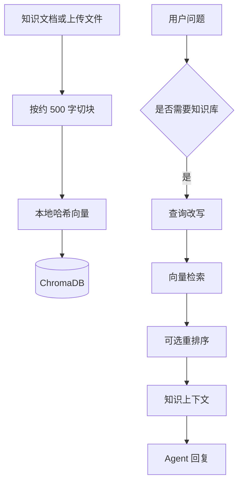

# EchoMind

> 面向企业服务场景的多 Agent 智能客服后端，融合意图识别、业务技能、RAG 知识库、长期记忆、监控评测与 Docker 化部署。

---

## 项目简介

EchoMind 是一个以 FastAPI 为入口的智能客服系统，目标是让企业能够用一套可部署、可观测、可扩展的 AI 后端承接员工或客户咨询。项目不是简单地把用户问题转发给大模型，而是在请求进入后依次完成意图识别、知识库检索、对话记忆读取、业务技能注入、多 Agent 路由与质量评测，从而让回答更贴近具体业务制度和历史上下文。

项目适合企业内部 IT、HR、财务、行政等服务台，也适合面向客户的技术支持、账单咨询与通用客服。它把 AI 客服常见的几个工程问题放在同一个后端中处理：如何识别问题类型、如何选择合适 Agent、如何接入知识库、如何保留用户上下文、如何监控质量与延迟，以及如何用容器快速部署。

## 核心能力

### 多 Agent 智能路由

**功能**：系统内置 `GeneralAgent`、`TechnicalAgent`、`BillingAgent` 与升级处理路径，`AgentOrchestrator` 根据意图、紧急程度和领域关键词选择合适 Agent。  
**解决的问题**：单一 Agent 容易用同一种回答风格处理所有问题，技术故障、账单退款和普通咨询的处理逻辑难以区分。  
**价值**：让不同类型问题进入更合适的提示词和处理路径，复合问题还可以并行调用多个 Agent 后合并回答。

### 三路融合意图识别

**功能**：`IntentRecognizer` 结合 LLM 语义理解、Embedding 相似度和关键词规则识别 `QUERY`、`TECHNICAL`、`BILLING`、`ESCALATION` 等 10 类意图，并给出紧急程度。  
**解决的问题**：仅靠关键词规则容易误判，仅靠 LLM 又会增加延迟和成本。  
**价值**：在准确性、速度与可用性之间取得平衡；当远端 Embedding 不可用时，项目还提供本地哈希向量兜底。

### RAG 知识库检索

**功能**：通过 `MCPToolManager` 注册 `knowledge_search` 工具，底层使用 `KnowledgeBase` 将文档切块后写入 ChromaDB，并在问答时执行语义检索。  
**解决的问题**：大模型自身不了解企业内部制度、产品规则或历史知识，容易回答空泛或编造。  
**价值**：把知识库结果作为上下文注入 Agent，让回答能够引用企业自己的知识来源，并支持文件上传和批量文档写入。

### 三级记忆体系

**功能**：`MemoryManager` 使用 Redis 管理工作记忆，使用 ChromaDB 存储情景记忆和用户画像，并在对话过程中读取历史上下文。  
**解决的问题**：客服对话通常不是单轮问答，用户会补充信息、追问细节或延续历史问题。  
**价值**：系统可以在多轮对话中保留上下文，并在历史消息过长时压缩摘要，减少上下文窗口浪费。

### 动态 Skills 注入

**功能**：`SkillManager` 启动时扫描 `skills/` 目录下的 `SKILL.md` 文件，根据关键词和 Agent 类型动态注入业务规则。当前项目包含 HR、财务、行政、IT 运维等业务技能。  
**解决的问题**：不同企业、部门和业务线的规则差异很大，硬编码到 Agent 中会导致维护困难。  
**价值**：通过 Markdown 技能文件扩展业务能力，不需要改动核心 Agent 代码即可增加新的业务知识和回复约束。

### 监控与评测闭环

**功能**：`PerformanceMonitor` 采集 Agent 成功率、延迟、工具调用状态并暴露 Prometheus 指标；`EndToEndEvaluator` 支持意图识别和多轮对话质量评测。  
**解决的问题**：AI 客服上线后需要持续观察稳定性、回答质量和回归风险。  
**价值**：让系统具备工程化运维基础，监控结果还可以反向影响 Agent 路由权重。

## 效果展示

### 输入示例

```json
{
  "message": "我登录 ERP 一直报 500，而且昨天的差旅发票也不知道能不能报销",
  "user_id": "u_1001",
  "conv_id": "conv_abc"
}
```

### 输出示例

```json
{
  "conv_id": "conv_abc",
  "response": "我先帮你拆成两个问题：ERP 500 报错建议先记录报错时间、截图和账号环境，并提交 IT 工单；差旅发票需要确认抬头、税号和费用类别是否符合财务规范，最终仍需在财务系统提交审核。",
  "intent": "TECHNICAL",
  "agent_type": "technical",
  "escalated": false,
  "latency_ms": 1280.4,
  "knowledge_used": true
}
```

<!-- TODO: 添加系统运行截图、Swagger 页面截图或监控面板截图。 -->

## 应用场景

- **企业内部服务台**：员工咨询入职、请假、报销、会议室、账号权限等问题时，EchoMind 可以按业务技能给出制度化回复。
- **客户技术支持**：用户反馈登录失败、接口报错、系统崩溃等问题时，系统会优先路由到技术 Agent 并结合知识库给出排查路径。
- **账单与订单咨询**：涉及退款、发票、订阅、扣款等问题时，账单 Agent 可以按业务规则给出说明并提示必要的人工处理边界。
- **知识库问答入口**：通过 `/knowledge/add`、`/knowledge/upload` 写入企业知识后，`/chat` 会在需要时自动检索并注入上下文。
- **AI 客服质量评测**：通过 `/eval/run` 对意图识别、多轮对话质量和回归风险进行验证，适合上线前或版本迭代后使用。

## 安装部署

### 环境要求

| 组件 | 要求 | 说明 |
|------|------|------|
| Python | 3.12 推荐 | Dockerfile 基于 `python:3.12-slim` |
| Docker | 推荐 | 用于一键启动 Redis、ChromaDB、Prometheus、Nginx 与主应用 |
| Redis | 7.x | 工作记忆与短期缓存 |
| ChromaDB | 0.5.23 | 向量知识库、情景记忆与用户画像 |
| Anthropic 兼容 API | 必需 | 读取 `ANTHROPIC_API_KEY`、`ANTHROPIC_MODEL`、`ANTHROPIC_BASE_URL` |


### 方式一：Docker Compose 部署

```bash
cp .env.example.env .env
# 编辑 .env，至少填写 ANTHROPIC_API_KEY，并按需设置 ANTHROPIC_MODEL / ANTHROPIC_BASE_URL
docker compose up -d --build
```

启动后常用地址：

| 地址 | 作用 |
|------|------|
| `http://localhost:8000/health` | 健康检查 |
| `http://localhost:8000/docs` | FastAPI Swagger 文档 |
| `http://localhost:8000/monitor` | 运行监控摘要 |
| `http://localhost:8000/metrics` | Prometheus 指标 |
| `http://localhost:8001` | ChromaDB 宿主机映射端口 |
| `http://localhost:9090` | Prometheus |

项目也提供了部署脚本：

```bash
chmod +x docker-deploy.sh
./docker-deploy.sh deploy
```

### 方式二：本地 Python 运行

本地运行适合开发调试，但仍需要 Redis 和 ChromaDB 可用。

```bash
python -m venv .venv
source .venv/bin/activate
pip install -r requirements.txt
cp .env.example.env .env
# 编辑 .env，填写 ANTHROPIC_API_KEY，并确认 REDIS_URL、CHROMA_HOST、CHROMA_PORT
python -m uvicorn api.main:app --host 0.0.0.0 --port 8000 --reload
```

Windows PowerShell 可将激活虚拟环境命令替换为：

```powershell
.\.venv\Scripts\Activate.ps1
```

## 快速开始

完成部署后，先检查服务健康状态：

```bash
curl http://localhost:8000/health
```

发起一次对话：

```bash
curl -X POST http://localhost:8000/chat \
  -H "Content-Type: application/json" \
  -d '{"message":"你好，我想了解报销流程","user_id":"demo-user"}'
```

也可以打开 `http://localhost:8000/docs`，在 Swagger UI 中直接调试 `/chat`、`/search`、`/knowledge/add`、`/eval/run` 等接口。

## 使用说明

### 核心接口

| 方法 | 路径 | 作用 |
|------|------|------|
| `GET` | `/health` | 服务健康检查 |
| `POST` | `/chat` | 主对话入口，返回意图、Agent 类型、是否升级、是否使用知识库 |
| `POST` | `/search` | 直接搜索知识库 |
| `POST` | `/knowledge/add` | 批量添加知识文档 |
| `POST` | `/knowledge/upload` | 上传文件并写入知识库 |
| `GET` | `/knowledge/stats` | 查看知识库文档片段数量 |
| `GET` | `/skills` | 查看已加载 Skills |
| `POST` | `/skills/reload` | 重新加载 Skills |
| `GET` | `/monitor` | 查看运行监控摘要 |
| `GET` | `/metrics` | Prometheus 指标 |
| `POST` | `/eval/run` | 运行端到端评测 |

### 添加知识库文档

```bash
curl -X POST "http://localhost:8000/knowledge/add" \
  -H "Content-Type: application/json" \
  -d '{
    "documents": [
      {
        "title": "报销制度",
        "content": "差旅发票需要抬头、税号、费用类别符合公司财务规范。"
      }
    ]
  }'
```

### 查看已加载业务技能

```bash
curl http://localhost:8000/skills
```

当前默认业务技能位于 `skills/`：

| 技能目录 | 业务范围 |
|----------|----------|
| `skills/hr_agent` | 入职、试用期、考勤、假期、社保、公积金、离职等人事问题 |
| `skills/finance_agent` | 报销、发票、差旅、补贴、对公付款等财务问题 |
| `skills/admin_agent` | 会议室、办公用品、门禁、访客、工位等行政问题 |
| `skills/it_agent` | 账号、权限、网络、办公软件、系统登录和数据导出等 IT 问题 |

## 系统架构



| 模块 | 职责 |
|------|------|
| `api/main.py` | FastAPI 应用入口，负责生命周期装配、路由暴露和 `/chat` 主链路 |
| `agents/agent_orchestrator.py` | Agent 路由、并行协作、失败降级与运行统计 |
| `core/intent_recognizer.py` | 多策略意图识别、紧急程度判断、实体提取和在线学习 |
| `core/skill_loader.py` | 扫描并加载 `SKILL.md`，按关键词和 Agent 类型动态注入提示词 |
| `memory/conversation_memory.py` | 工作记忆、情景记忆、用户画像与历史上下文构建 |
| `mcp/tool_manager.py` | 工具注册、参数校验、缓存、熔断、查询改写和重排序 |
| `mcp/knowledge_base.py` | 文档切块、向量写入、语义检索和默认知识加载 |
| `monitor/performance_monitor.py` | 性能采集、异常检测、告警和路由惩罚建议 |
| `evaluation/evaluator.py` | 意图识别评测、对话质量打分、回归检测和报告记录 |

## 核心工作流程



1. **请求进入**：`/chat` 接收 `message`、`user_id` 和可选 `conv_id`，没有会话 ID 时自动生成。
2. **上下文准备**：系统读取 Redis 中的近期对话，同时从 ChromaDB 中检索用户相关的情景记忆和画像。
3. **RAG 判定**：寒暄类短句会跳过知识库；业务关键词或长度足够的问题会触发知识库检索。
4. **Agent 编排**：意图识别结果进入 `AgentOrchestrator`，系统按意图、紧急程度和关键词选择单 Agent 或多 Agent 并行协作。
5. **记忆写入**：用户消息和 Agent 回复都会写入工作记忆，历史过长时压缩为摘要并进入情景记忆。
6. **监控评测**：后台监控采集延迟、成功率和异常，评测模块可按需运行端到端质量检查。

## AI 工作流程

### Agent 架构



`BaseAgent` 统一封装 Anthropic 兼容 API 调用、系统提示词构建、Skills 注入、响应清洗和升级关键词检测。专属 Agent 失败时，编排器会降级到通用 Agent，避免单点 Agent 异常导致请求完全失败。

### Prompt Pipeline



系统提示词由四部分组成：Agent 固定职责、业务 Skills、对话记忆、知识库检索结果。`SkillManager` 会按关键词和 Agent 类型筛选技能，并用 `ECHOMIND_SKILLS_MAX_PROMPT_CHARS` 控制注入长度，避免上下文膨胀。

### RAG 流程



`KnowledgeBase` 使用本地确定性向量兜底，降低外部 Embedding 服务不可用时的部署门槛。`MCPToolManager` 还提供工具级缓存、熔断和降级结果，避免知识库短时异常影响主链路稳定性。

### LLM 使用方式

| 环节 | 模型配置 | 作用 |
|------|----------|------|
| 意图识别 | `ANTHROPIC_MODEL` | Few-shot 判断意图、置信度和理由 |
| Agent 回复 | `ANTHROPIC_MODEL` | 生成最终客服回复 |
| 查询改写 | `ANTHROPIC_MODEL` | 为知识库检索生成多个查询变体 |
| 重排序 | `ANTHROPIC_MODEL` | 对检索结果做语义相关性排序 |
| 质量评测 | `ANTHROPIC_MODEL` | 对多轮对话结果进行质量打分 |

项目读取 `ANTHROPIC_BASE_URL`，因此可连接官方 Claude，也可接入兼容 Anthropic 协议的第三方模型端点。Embedding 当前主要采用本地实现，以减少模型下载和外部依赖。

## 技术栈

| 层级 | 技术 | 用途 | 选型理由 |
|------|------|------|----------|
| Web 框架 | FastAPI | HTTP API、Swagger 文档、文件上传 | 异步支持好，接口定义简洁，适合 AI 后端 |
| ASGI 服务 | Uvicorn | 运行 FastAPI 应用 | 轻量、成熟、容器部署友好 |
| LLM SDK | `anthropic` | 调用 Claude 或兼容端点 | 支持统一的 Anthropic 消息接口 |
| 数据校验 | Pydantic v2 | 请求和响应模型 | 与 FastAPI 深度集成 |
| 工作记忆 | Redis | 近期对话和缓存 | 读写快，适合短期上下文 |
| 向量存储 | ChromaDB | 知识库、情景记忆、用户画像 | 部署简单，支持持久化 |
| HTTP 客户端 | httpx | Webhook 告警和外部请求 | 异步友好 |
| 监控 | Prometheus Client | 指标暴露 | 易接入 Prometheus/Grafana |
| 容器化 | Docker / Docker Compose | 应用、Redis、ChromaDB、Prometheus、Nginx 编排 | 便于本地和生产环境一致部署 |
| 反向代理 | Nginx | 对外入口和健康检查 | 常见生产部署组件 |

## 项目结构

```text
EchoMind-project/
├── api/
│   └── main.py                 # FastAPI 入口、生命周期装配、HTTP 路由
├── agents/
│   └── agent_orchestrator.py   # 多 Agent 定义、路由、并行协作、降级
├── core/
│   ├── intent_recognizer.py    # LLM + Embedding + 规则的意图识别
│   ├── skill_loader.py         # Markdown Skills 加载与动态提示词注入
│   └── embedding_client.py     # 远端 Embedding 客户端预留实现
├── memory/
│   └── conversation_memory.py  # Redis 工作记忆、ChromaDB 情景记忆和用户画像
├── mcp/
│   ├── knowledge_base.py       # 知识库切块、向量化、检索
│   └── tool_manager.py         # 工具注册、缓存、熔断、查询改写、重排
├── monitor/
│   └── performance_monitor.py  # 性能采集、异常检测、告警和路由惩罚
├── evaluation/
│   └── evaluator.py            # 意图识别和端到端对话质量评测
├── skills/
│   ├── admin_agent/SKILL.md    # 行政办公业务规则
│   ├── finance_agent/SKILL.md  # 财务报销业务规则
│   ├── hr_agent/SKILL.md       # HR 人事业务规则
│   └── it_agent/SKILL.md       # IT 运维业务规则
├── config/
│   ├── nginx/nginx.conf        # Nginx 配置
│   └── prometheus.yml          # Prometheus 抓取配置
├── Dockerfile                  # 多阶段镜像构建
├── docker-compose.yml          # Redis、ChromaDB、Prometheus、EchoMind、Nginx 编排
├── docker-deploy.sh            # Docker Compose 部署辅助脚本
├── build-image.sh              # 镜像构建脚本
├── run-image.sh                # 容器运行脚本
├── requirements.txt            # Python 依赖
└── .env.example.env            # 环境变量示例
```

## 配置说明

### 必需配置

| 变量名 | 必需 | 默认值 | 说明 |
|--------|------|--------|------|
| `ANTHROPIC_API_KEY` | 是 | - | Anthropic 或兼容端点 API Key |
| `ANTHROPIC_MODEL` | 否 | `claude-3-5-sonnet-20241022` | Agent、意图识别、查询改写和评测使用的模型 |
| `ANTHROPIC_BASE_URL` | 否 | 官方端点 | 兼容 Anthropic 协议的第三方接口地址 |

### 服务配置

| 变量名 | 必需 | 默认值 | 说明 |
|--------|------|--------|------|
| `API_HOST` | 否 | `0.0.0.0` | API 监听地址 |
| `API_PORT` | 否 | `8000` | API 监听端口 |
| `LOG_LEVEL` | 否 | `INFO` | 日志级别 |
| `REDIS_URL` | 否 | `redis://redis:6379/0` | Redis 连接地址，Compose 内会覆盖为服务名 |
| `REDIS_PASSWORD` | 否 | `echomind123` | Compose 中 Redis 密码 |
| `CHROMA_HOST` | 否 | `chromadb` | ChromaDB 主机 |
| `CHROMA_PORT` | 否 | `8000` | ChromaDB 容器端口，本地宿主映射通常为 `8001` |
| `CHROMA_PERSIST_DIRECTORY` | 否 | `/app/data/chroma` | ChromaDB 持久化目录 |
| `ECHOMIND_SKILLS_DIR` | 否 | `./skills` | Skills 根目录 |
| `ECHOMIND_SKILLS_MAX_PROMPT_CHARS` | 否 | `5000` | Skills 注入提示词总长度上限 |
| `PROMETHEUS_PORT` | 否 | `9090` | 应用内 Prometheus 指标端口，`0` 表示不启动独立端口 |
| `MONITOR_INTERVAL` | 否 | `10` | 监控采集间隔，单位秒 |
| `EVAL_BASELINE_PATH` | 否 | `./data/eval/baseline.json` | 评测基线文件路径 |

## 性能与扩展性

- **Agent 池化路由**：`AgentOrchestrator` 通过 `routing_score()` 结合成功率、平均延迟和监控惩罚选择 Agent，为后续扩展多实例 Agent 池预留空间。
- **工具缓存与熔断**：`MCPToolManager` 对工具调用结果做 TTL 缓存，并在连续失败后进入熔断状态，减少下游异常对主链路的影响。
- **知识库检索优化**：查询改写和重排序提高召回质量，知识库结果在进入上下文前会截断，控制 LLM 输入成本。
- **记忆压缩**：工作记忆超过阈值后压缩为摘要并写入情景记忆，避免多轮对话持续拉长上下文。
- **容器化横向扩展**：主应用是无状态 API 加外部 Redis/ChromaDB，适合在生产环境中通过多副本和反向代理扩展。

## 安全设计

- **密钥隔离**：API Key、JWT Secret、Redis 密码等均通过 `.env` 注入，不应提交真实密钥。
- **业务边界**：Skills 中明确约束 HR、财务、行政、IT 的回答边界，例如不得审核个人单据、不得泄露隐私、不得提供越权操作方案。
- **人工升级**：紧急或无法处理的问题可进入升级路径，避免模型在高风险场景中强行回答。
- **容器非 root 运行**：生产镜像创建 `echomind` 用户运行应用，并限制运行期写入目录。
- **反向代理与监控**：Nginx 作为入口，Prometheus 指标和健康检查用于发现异常状态。

需要注意：当前 `api/main.py` 的 CORS 配置为 `allow_origins=["*"]`，如果面向公网部署，建议按实际前端域名收紧跨域策略。

## 项目亮点

1. **多策略意图识别**：LLM、Embedding 和规则协同工作，在准确率、延迟和可用性之间取得平衡。
2. **业务 Skills 插拔机制**：通过 `SKILL.md` 扩展业务规则，让 Agent 能按企业制度回答，而不是只依赖通用模型能力。
3. **记忆与知识库分层**：Redis 处理短期工作记忆，ChromaDB 处理知识库、情景记忆和用户画像，职责清晰。
4. **工程化可观测性**：内置 Prometheus 指标、异常检测、告警 Webhook、Agent 路由惩罚和端到端评测。
5. **部署闭环完整**：提供 Dockerfile、docker-compose、Nginx、Prometheus、构建脚本和运行脚本，便于从开发到生产迁移。

## Roadmap

- [x] FastAPI 主服务与 Swagger 调试入口
- [x] 多 Agent 路由与复合问题并行协作
- [x] LLM + Embedding + 规则的意图识别
- [x] Redis 工作记忆与 ChromaDB 长期记忆
- [x] RAG 知识库写入、上传与检索
- [x] Markdown Skills 动态加载
- [x] Prometheus 指标与性能监控
- [x] 端到端质量评测框架
- [ ] 增加正式的自动化测试目录和 CI 流水线
- [ ] 增加认证鉴权中间件，保护知识库写入、评测和监控接口
- [ ] 为 Grafana 增加可直接导入的标准仪表盘
- [ ] 增加多租户知识库隔离和权限控制
- [ ] 提供前端管理台，用于维护 Skills、知识库和评测用例

## 贡献指南

### 本地开发

```bash
python -m venv .venv
source .venv/bin/activate
pip install -r requirements.txt
cp .env.example.env .env
python -m uvicorn api.main:app --reload
```

### 添加新业务技能

在 `skills/` 下创建一个目录，并添加 `SKILL.md`：

```text
skills/
└── legal_agent/
    └── SKILL.md
```

推荐内容结构：

```markdown
# 法务咨询Agent

## 角色定位
说明这个 Agent 的业务身份。

## 业务规则
列出可回答范围、禁止范围和流程要求。

## 回复约束
说明不能承诺、不能编造、需要转人工的情况。

## 匹配关键词
合同,法务,协议,用印,合规
```

修改后可调用：

```bash
curl -X POST http://localhost:8000/skills/reload
```

### 提交建议

- 保持模块边界清晰，Agent、记忆、工具、监控、评测不要互相硬耦合。
- 新增接口时同步更新 Swagger 可读的请求/响应模型。
- 涉及提示词、业务规则或安全边界的修改，应在 `skills/` 或文档中说明原因。
- 推荐使用 Conventional Commits，例如 `feat: add legal skill`、`fix: handle chroma fallback`。

## FAQ

### 启动时报“未设置 ANTHROPIC_API_KEY”怎么办？

复制 `.env.example.env` 为 `.env`，填写 `ANTHROPIC_API_KEY`。如果使用兼容 Anthropic 协议的第三方端点，还需要设置 `ANTHROPIC_BASE_URL` 和对应模型名。

### 本地运行时 ChromaDB 连接失败怎么办？

如果使用 Docker Compose，应用容器内使用 `chromadb:8000`；如果本地 Python 直跑，通常应设置 `CHROMA_HOST=localhost`、`CHROMA_PORT=8001`，因为 Compose 将 ChromaDB 映射到了宿主机 `8001` 端口。

### 为什么有些问题没有触发知识库？

`_should_use_knowledge()` 会跳过纯寒暄短句，只有消息长度足够或命中业务关键词时才触发 RAG。这样可以减少无意义检索和额外延迟。

### 如何让系统支持新的部门或业务线？

优先新增 `skills/<业务名>/SKILL.md`，用关键词和业务规则描述该领域。如果需要专门路由逻辑，再扩展 `AgentType`、`_INTENT_ROUTING` 或 `_collaboration_targets()`。

### 生产环境需要注意什么？

至少需要替换默认密钥、收紧 CORS、限制管理类接口访问、持久化 Redis/ChromaDB 数据、接入监控告警，并避免把真实 `.env` 提交到仓库。

